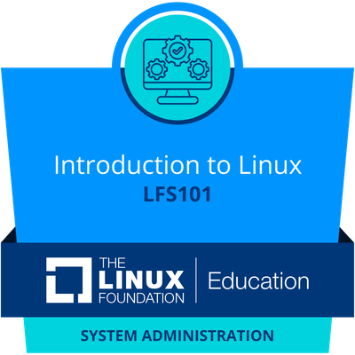

# Hi, I'm Dennis Chigozirim 👋

**Cloud/DevOps Engineer.** I'm teaching myself the craft through hands-on projects, and I write up every one of them: what I built, what broke, and what I learned.

[🌐 Portfolio](https://devopsavatar.github.io) · [💼 LinkedIn](https://www.linkedin.com/in/chigozirim-dennis-243ba237b/) · [📁 Cloud projects](https://github.com/DevOpsAvatar/cloud-architecture-projects-AWS-Azure-GCP) · [🧪 Lab](https://github.com/DevOpsAvatar/lab)

---

## 🛠️ What I've built so far

| Project | What it shows | Tools |
| --- | --- | --- |
| [Deploy a backend with Kubernetes](https://github.com/DevOpsAvatar/cloud-architecture-projects-AWS-Azure-GCP/tree/main/deploy-backend-with-kubernetes) | Applied Deployment and Service manifests with `kubectl` to run a Flask backend on EKS, then verified in the EKS console that the pods pulled the image from ECR and started cleanly. | Kubernetes, kubectl, Amazon EKS, ECR, Docker, IAM |
| [Create Kubernetes manifests](https://github.com/DevOpsAvatar/cloud-architecture-projects-AWS-Azure-GCP/tree/main/create-kubernetes-manifests) | Wrote Deployment and Service manifests that run a Flask backend from Amazon ECR on EKS and route traffic to its pods with a NodePort Service. | Kubernetes, YAML manifests, Amazon EKS, ECR, Docker |
| [Set up a Kubernetes deployment on EKS](https://github.com/DevOpsAvatar/cloud-architecture-projects-AWS-Azure-GCP/tree/main/set-up-kubernetes-deployment) | Created a three-node EKS cluster, built a Docker image of a Flask backend, and pushed it to Amazon ECR so the cluster can pull it. | Amazon EKS, ECR, Docker, Flask, eksctl, kubectl |
| [Launch a Kubernetes cluster on Amazon EKS](https://github.com/DevOpsAvatar/cloud-architecture-projects-AWS-Azure-GCP/tree/main/launch-a-kubernetes-cluster) | Created a managed cluster with `eksctl`, tracked it in CloudFormation, granted access with an IAM access entry, and watched the node group replace deleted nodes on its own. | Amazon EKS, eksctl, CloudFormation, IAM, EC2 |
| [Build a Kubernetes controller](https://github.com/DevOpsAvatar/lab/tree/main/build-a-kubernetes-controller) | Wrote a custom controller whose reconciliation loop restores the desired replica count after manual changes and reports status back to the API server. | Go, Kubebuilder, kind, kubectl, CRDs |
| [Host a website on Amazon S3](https://github.com/DevOpsAvatar/cloud-architecture-projects-AWS-Azure-GCP/tree/main/aws-host-a-website-on-s3) | Hosted a static site on S3, diagnosed a 403 Forbidden error, and fixed it by changing access permissions. | Amazon S3, static website hosting, ACLs |

More are on the way. I add each one as soon as I finish it.

---

## 🧰 Tools and skills

| Area | What I work with |
| --- | --- |
| Cloud | AWS (EC2, S3, EKS, IAM, CloudFormation), Azure and GCP basics |
| Containers and orchestration | Kubernetes, Docker, kind, kubectl, eksctl, Kubebuilder |
| Scripting | Bash |
| CI/CD | Jenkins, GitHub Actions |
| Infrastructure as code | CloudFormation, Terraform (learning) |
| Where I'm heading | DevSecOps, observability, MLOps pipelines |

---

## 🏅 Badges

**Introduction to Linux (LFS101)**, The Linux Foundation. I completed this course to build my foundation in Linux system administration. [Verify the badge on Credly](https://www.credly.com/badges/7b38863d-0ec8-4153-b35d-7744be24d97c/public_url).

 

---

## 🎯 What I'm working on now

- Learning **Jenkins** and CI/CD pipelines
- Going deeper into **Kubernetes**, including operators and admission webhooks
- Building **Infrastructure as Code** skills with Terraform
- Building a Linux and Bash scripting foundation
- Working toward **MLOps**: packaging and deploying machine learning workflows

---

## 💡 How I work

- **Build it, break it, write it up.** Every project gets a README with the problems I hit and how I fixed them.
- **Clean up after myself.** I delete cloud resources when I'm done so I don't run up costs.
- **Show progress in public.** My repos and portfolio are the record of how I'm improving.

---

## 📫 Let's connect

I'm open to learning opportunities, collaboration and conversations with people working in DevOps and cloud. The best way to reach me is on [LinkedIn](https://www.linkedin.com/in/chigozirim-dennis-243ba237b/).
